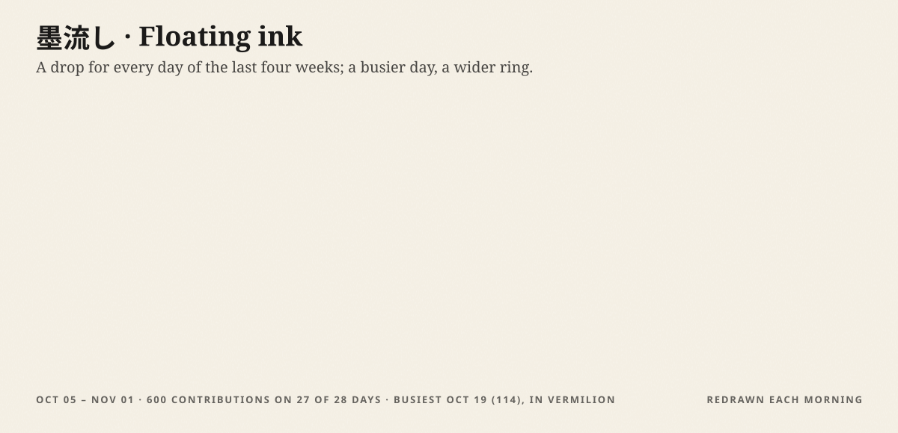

One day with Latte (ラテ, head of QA), playing by itself. On <a href="https://bacuslee.com">bacuslee.com</a> it follows your scroll.

&nbsp;
&nbsp;

| 起 · [**OkiPaca** ↗](https://apps.apple.com/us/app/okipaca-scan-alarm-clock/id6781800840) | 本 · [**HonPaca** ↗](https://honpaca.com/) | 譜 · [**AnyScore** ↗](https://anyscore.app/) |
| --- | --- | --- |
| An iPhone alarm that stops only when you prove you are up: scan a QR code or barcode, tap an NFC tag, find an object on camera, or count reps. SWIFTUI · ALARMKIT · VISIONKIT · CORE NFC · SWIFTDATA · ON-DEVICE SIGLIP2 · SCREEN TIME | An EPUB reader that feels like paper. Ask about the book and every answer cites its passages, only up to where you have read. SWIFTUI · READIUM · SUPABASE: POSTGRES AND EDGE FUNCTIONS · APP ATTEST | Import MusicXML, a PDF or a photo of a score, play it on your piano, and it waits for the right note. FLUTTER · MIDI · TFLITE · SUPABASE · AUDIVERIS OMR WORKER IN PYTHON |

### More work

- **[SchemaSnap](https://www.schemasnap.app/)** SAAS · AI · IN DEVELOPMENT Maps diverse data sources onto report templates with AI, so complex reports write themselves.
- **[Cookie Shield](https://chromewebstore.google.com/detail/aaflponmjepfbnninhobpkfemghjeclp)** BROWSER EXTENSION · PRIVACY Finds GDPR and CCPA cookie banners and rejects them for you.
- **[Chess Notation Tracker](https://github.com/bacuslee/Chess-Notation)** COMPUTER VISION · PYTHON · PYTORCH · OPENCV Reads an over-the-board game from a phone camera, square by square, and reviews it with Stockfish.

Write to me: <a href="mailto:bacuslee@gmail.com">bacuslee@gmail.com</a> · <a href="https://bacuslee.com">bacuslee.com</a> · <a href="https://sg.linkedin.com/in/bacus-lee-a35245146">LinkedIn</a> · Singapore, GMT+8

The paintings were generated for bacuslee.com and the app screens are untouched captures. Type is Shippori Mincho B1 (SIL Open Font License). The kanji strokes come from KanjiVG © Ulrich Apel (CC BY-SA 3.0). Every image here is a hand-built SVG with no script, and the bath is redrawn each morning by a GitHub Action. <a href="docs/MAKING-OF.md">How it was made</a>.
